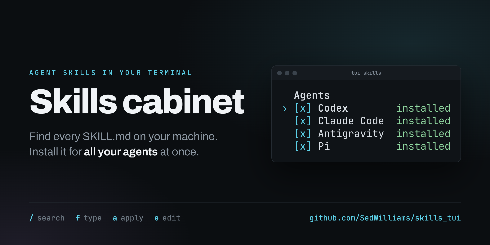
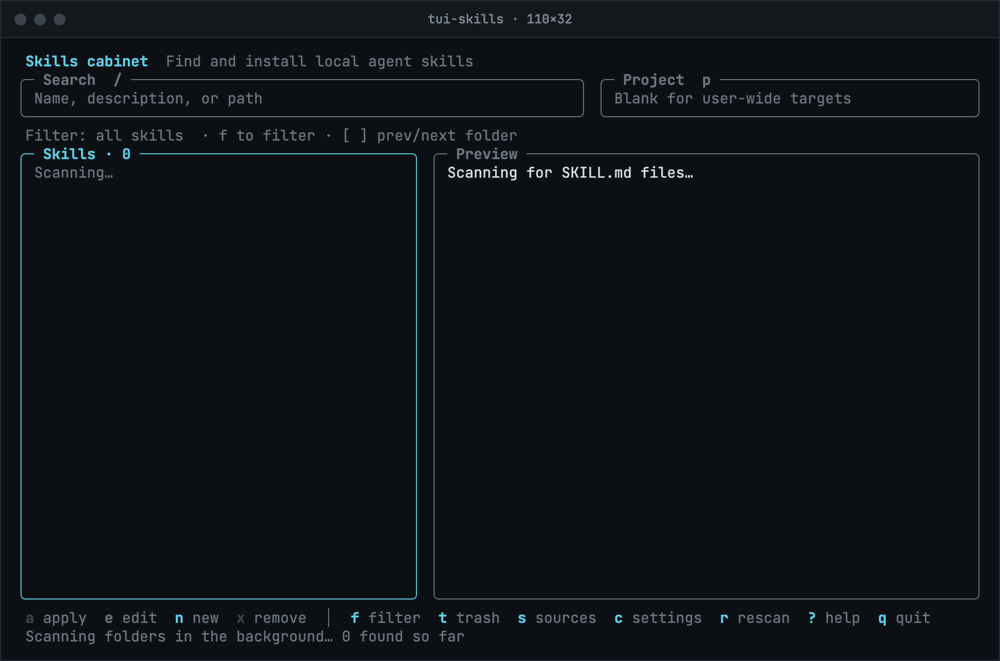

<div align="center">



# Skills cabinet

**Find, fix, and install the agent skills scattered across your disk.**

[](LICENSE)
[](https://nodejs.org)
[](#quick-start)

</div>

Codex, Claude Code, Antigravity, and Pi each read skills from their own folders. Skills pile up in all of them, in cloned skill packs, and in Downloads. Skills cabinet scans your disk for every `SKILL.md`, shows which agents already have each skill, and flags broken frontmatter. Pick a skill and some agents, and it copies or links the folder into each agent's skills directory. Editing a skill backs up the original first.

The app is written in TypeScript with Ink. You don't need API keys or a running agent.



## Quick start

You need Node.js 20 or newer.

```sh
git clone https://github.com/SedWilliams/skills_tui.git
cd skills_tui
./run.sh
```

The launcher installs dependencies and builds the app on first use, and rebuilds after source changes. The layout fits terminals down to 80×24. Colors follow your terminal theme.

To run `tui-skills` from any directory, build and link it once. Run `npm run build` again after you pull changes.

```sh
npm install
npm run build
npm link
```

The launcher and `tui-skills` take the same flags:

```sh
./run.sh --root ~/Desktop/dev --root /Volumes/Projects
./run.sh --project ~/Desktop/dev/my-project
./run.sh --config-dir /tmp/skills-demo
```

`--root` adds folders to scan for this session. Save Sources or Settings to keep them for next time. `--config-dir` changes where the app stores its data. It still scans your home directory and uses your usual agent folders by default.

## Use

The left pane lists skills. The right pane shows the selected skill's location, install status, validation errors, description, and instructions. The app is keyboard-driven. The key bar at the bottom always shows the keys for the current screen.

| Key | Action |
| --- | --- |
| ↑ ↓ / j k | Select a skill. g and G jump to the first and last |
| PgUp PgDn | Scroll the preview |
| / | Search names, descriptions, and paths. Enter keeps the search, Esc clears it |
| f | Filter by folder, install status, or tag. See [Filtering](#filtering) |
| [ ] | Step to the previous or next folder at the same level |
| p | Set a project directory for project-local targets. Blank means user-wide |
| Enter / a | Apply: choose agents and copy or link the complete skill folder |
| e | Edit the selected skill |
| n | Create a `SKILL.md` in the app's library |
| x | Move the selected folder to the app's trash after confirmation |
| t | Trash: restore removed folders and links |
| s | Sources: set scan folders, one path per line |
| c | Settings: edit library, agent targets, scan roots, and exclusions as JSON |
| r | Rescan in the background |
| ? | Help, including scan warnings |
| q | Quit |

The editor supports Ctrl+S to save, Esc to cancel (it asks before discarding changes), and Ctrl+Z to undo. Ctrl+G opens the text in `$VISUAL` or `$EDITOR` and loads the result back when you exit.

In Apply, use ↑ ↓ to move, Space to toggle an agent or the copy/link mode, A to toggle all agents, and Enter to apply. **x** uninstalls the selected agent copies or links. It lists the exact paths and asks for confirmation. When agents share a path, removing it affects both. The project field in Apply affects that operation only.

## Filtering

Press **f** to open the filter panel in place of the preview. It has three sections, and each row shows how many skills it would list:

- **Folders** shows where your skills live as a tree. A folder that leads to only one other folder merges into it, so `~/.codex/.tmp/plugins/plugins` is one row instead of four. → and ← open and close folders, and * opens every folder below the highlighted one.
- **Status** narrows to skills that are installed or not installed at the current targets, skills with invalid frontmatter, or skills that share a name with another skill.
- **Tags** lists the `type`, `category`, and `tags` values from skill frontmatter.

The skill list previews whichever row you highlight. Space selects the row and keeps the panel open, so you can combine a folder with a status or a tag. Enter selects the row and closes the panel. Esc closes the panel without selecting the highlighted row.

To read a large collection in pieces, select one folder, go through its skills, then press **]** for the next folder at the same level or **[** for the previous one. Folders with no matching skills are skipped. When a level runs out, the next step goes past the parent folder.

Search and filters combine. Each count reflects the search and the other filters, so with **Not installed** selected, the folder counts show where your uninstalled skills are. While searching, Tab opens the filter panel. Esc in the skill list clears the search and every filter. Filters last for the current session.

To tag a skill, add `type: marketing`, `category: writing`, or `tags: [marketing, writing]` to its YAML frontmatter. These fields also work inside a `metadata` mapping. Tags are lowercase, with spaces and underscores converted to hyphens.

## Discovery

The first launch scans your home directory, the app's library, and all configured user-wide targets. Hidden directories are included. Add directories anywhere on disk through Sources or `--root`.

The scanner looks for `SKILL.md`. Once it finds one, it treats that folder as a skill and stops searching inside it. It ignores Markdown files with other names. Skills with invalid frontmatter stay in the list so you can fix them.

Scans skip Git internals, virtual environments, `node_modules`, `Library`, and common caches by default. To find skills inside a skipped folder, add the skill directory itself in Sources. Check Help for permission errors. The scanner lists each physical folder once and skips symlink cycles.

## Agent targets

| Agent | User-wide | Project-local |
| --- | --- | --- |
| Codex | `~/.agents/skills` | `<project>/.agents/skills` |
| Claude Code | `~/.claude/skills` | `<project>/.claude/skills` |
| Antigravity | `~/.gemini/config/skills` | `<project>/.agents/skills` |
| Pi | `~/.pi/agent/skills` | `<project>/.pi/skills` |

Antigravity versions differ. Older standalone IDE installations use `~/.gemini/antigravity/skills` and `<project>/.agent/skills`. Change the user-wide target in Settings for older versions. To use any custom project target, set its absolute path as a target in Settings and leave the project field blank. Legacy folders such as `~/.codex/skills` are discovered during the home scan.

Codex and Antigravity share the project-local `.agents/skills` directory, so one install serves both. Pi also reads `.agents/skills` and may find the skill there without a separate copy. The preview only checks whether a skill with that name exists in each target folder. It doesn't compare contents or check what an agent has loaded.

Reference documentation: [Codex](https://developers.openai.com/codex/skills/), [Claude Code](https://code.claude.com/docs/en/skills), [Antigravity](https://antigravity.google/docs/skills), [Pi](https://github.com/badlogic/pi-mono/blob/main/packages/coding-agent/docs/skills.md).

Restart or reload your agent after installing or editing skills. Pi supports `/reload`. This app writes files; it does not change an active agent session or translate agent-specific instructions.

## Copies, links, and safety

- Copy installs `SKILL.md` plus supporting scripts, references, and assets. Copies are independent snapshots.
- Link installs a directory symlink. Edits affect every agent using the same source. Keep that source in place.
- The app won't overwrite an existing destination. Remove the previous installation through Apply, then apply again.
- Copy mode rejects embedded symlinks rather than following them outside the skill. Use link mode for those skills.
- Editing backs up the original Markdown and refuses to overwrite a file changed externally since the editor opened.
- Remove moves the whole selected skill directory, including supporting files. Removing a symlink moves only the link. The confirmation states which operation will happen.
- Restore won't overwrite an existing path. The app keeps trash and backups until you delete them yourself.
- The app does not execute skills. Review unfamiliar instructions and supporting files before enabling them in an agent.

Configuration and data live in `~/.config/tui-skills` by default, or `$TUI_SKILLS_HOME`:

```text
config.json   Saved preferences, created when you save Sources or Settings
library/      New skills
backups/      Original SKILL.md versions saved before edits
trash/        Removed folders or links and their original paths
```

The editor checks the `name` and `description` fields before saving. Names must use lowercase letters, numbers, and single hyphens, up to 64 characters. Descriptions must contain text, up to 1024 characters. Changing `name` does not rename the source folder. New installations use the new name.

## Development

```sh
npm install
npm test            # vitest: core logic and headless UI sessions
npm run typecheck
npm run build       # compiles src/ to dist/
npm run assets      # rebuilds the README images from the real app
```

Tests use temporary directories and headless Ink sessions through `ink-testing-library`. They cover discovery, exclusions, malformed skills, filtering, copying assets, symlinks, overwrite protection, backups, trash restoration, and UI operations. They do not install skills into your real agents.

`npm run assets` builds the app and drives it through a scripted session in a throwaway home directory full of demo skills. Headless Chrome renders each frame, and the script writes the social card and demo GIF at the top of this page to `docs/assets/`. Run it after you change a screen so the README matches the app. It needs Node 22, Google Chrome, and Python 3.

```text
src/cli.tsx          command-line flags and startup
src/app.tsx          screens and key handling
src/components.tsx   panels, the key bar, and the text editors
src/core.ts          discovery, validation, installs, backups, and trash
src/filters.ts       the folder tree, filter counts, and folder steps
src/text.ts          display width, wrapping, and the Markdown preview
marketing/tools/     README image capture, not part of the app
docs/assets/         images this README shows
```

## Contributing

Issues and pull requests are welcome. See [CONTRIBUTING.md](CONTRIBUTING.md) for setup and the checks to run before a pull request.

## License

[MIT](LICENSE) © SedWilliams
